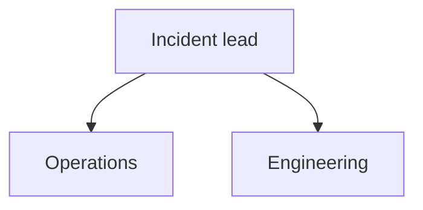

# PoolSense

PoolSense is a .NET 10 incident-assistance platform with an ASP.NET Core API, an Angular 18 operator console, NYRA gateway-backed inference, embedding, and Wiki document retrieval, and SQL Server persistence for knowledge, project configuration, ingestion tracking, feedback, telemetry, and operational logging.

PoolSense combines pool ticket history, project-scoped NYRA Wiki documents, and optional GitHub repository code. Code evidence uses the administrator-managed GitHub PAT for registered repositories; Wiki and Pool DB access behavior is unchanged.

See [GitHub Code Knowledge setup](CodeKnowledge.md) for PAT configuration, database setup, hourly refresh, security boundaries, and verification steps.

At a high level, PoolSense does four things:

1. Accepts an incident or ticket description from a user or integrated client.
2. Retrieves similar historical incidents and failure-pattern context.
3. Uses AI orchestration to generate a suggested root cause, resolution, confidence score, and reasoning.
4. Supports ongoing operations through project configuration, feedback capture, ingestion tracking, and email recommendation delivery.

## Core Capabilities

- Incident triage through the `POST /api/ticket/process` workflow.
- Similar-incident retrieval using stored embeddings and cosine similarity search over SQL Server-backed knowledge rows.
- AI-generated root cause, resolution, reasoning, confidence, and failure-pattern enrichment.
- Hybrid retrieval for every interactive question; configured, accessible code repositories also participate without a separate code-question mode.
- Code search uses bounded concurrent immutable-snapshot readers, explicit partial coverage and globally ranked/deduplicated source spans. Background refresh prepares source-linked OKF v0.2 knowledge and optional cached semantic vectors; routing, paid knowledge enrichment and semantic search have conservative gates. See [code retrieval architecture and configuration](CodeKnowledge.md#search-and-background-preparation).
- Background OKF producer 0.5 extracts source-grounded terminology, partial call workflows, calculations/SQL lineage and supported interface/configuration concepts. Search stages cached metadata, selected sections, bounded needed links and exact source spans before merging independent lexical evidence; generated drafts never replace code authority. Same-head preparation upgrades reuse local source and a transactionally rebased graph.
- This checkout enables progressive semantic coverage: repository-adaptive totals remain capped at 768 vectors, with at most 64 new vectors per background batch and a five-minute cooldown. Existing vectors are reused, and coverage displays indexed/eligible/target counts; reaching a configured target is not full-repository coverage.
- Retrieval caches warm asynchronously after the API is ready: up to eight published repository snapshots, with at most two warmers, plus the Pool-history vector cache. Warmup reuses validated local/SQL data only; it performs no embedding, GitHub, or LLM calls and does not skip user access checks. See [cache warmup configuration](CodeKnowledge.md#process-start-cache-warmup).
- Project-scoped NYRA Wiki document retrieval using comma-separated `nyra_kb_names` from `dbo.project_configs`.
- Background polling of a SQL Server ticket source for new tickets and closed-ticket knowledge ingestion.
- Application sync from `dbo.tbl_Application.PoolSense` into `dbo.project_configs` before each polling iteration.
- Project-based application scoping through `project_configs` and application filters.
- UI-based application administration for project rows, search scope, ingestion progress, and email settings.
- Master email kill switch (`PoolSenseEmail`) in application configuration suppresses all outbound emails when disabled, regardless of per-application settings.
- User activity audit trail capturing configuration changes, knowledge store operations, and sign-in/sign-out events in `dbo.user_activity_logs`.
- Dedicated application feedback capture with submitter name, email, stored comments, and a PoolSense Insights dashboard for feedback activity.
- Feedback capture with Helpful / Not Helpful rating, selected primary incident, current pool cause/fix note, and usage signal. Notes with a cause/fix are stored as standalone human-validated resolutions (`dbo.validated_resolutions`) that the resolution agent consults directly on future similar issues, in addition to ranking the selected historical incident.
- Operational insight endpoints for failures, systems, components, and timelines.
- Compact, collapsible desktop conversation history and an independently collapsible Operational context panel. Use Hide context / Show context in the triage toolbar to reclaim conversation space without losing evidence selections; narrow screens retain the full-width history drawer.
- The desktop PoolSense Console menu scrolls independently, keeping its header and account actions visible. On very short desktops the entire rail scrolls to keep every action reachable; narrow layouts retain their normal document flow.
- Saved Pool Recommendations workspace for `NewRecommendation` reports generated by background polling, with filters, report links, and saved-report troubleshooting that can refresh similar incidents and NYRA Wiki evidence.
- Recommendation email delivery through SMTP or SQL Server Database Mail.
- External API support for toggling `send_email` and updating semicolon-separated Lifeguard email recipients by `application_filter`.
- Bidirectional PoolSense flag updates: disabling or enabling a project in the PoolSense UI writes `PoolSense = 0/1` back to the ticket-source `dbo.tbl_Application` row.
- SQL Server-backed interaction logs, application logs, and LLM token usage tracking.

## Conversational follow-ups

Main chat follow-ups use server-authoritative history from the authenticated user's
owned conversations. History selection and **New chat** remain available while answers
stream; progress, drafts, errors and late results stay with their originating chat.
Up to three conversations can investigate concurrently, with one request per chat.
Pending chats cannot be deleted until they finish. Obsolete history reads are aborted,
and signing out aborts active browser requests and discards their UI state.

Follow-ups use the
owned `ChatSessionId`; clients do not supply conversation contents. Reopened saved
chats can continue without replaying previous RAG requests. Unknown/foreign session
IDs or a different selected application scope start an isolated new session.
Changing scope in the UI clears the current chat and shows an explicit notice;
it does not delete the previous conversation.

Continuation reads fetch only the latest six owned messages, in chronological
order; reopening a conversation still returns its full saved history.
The context window contains at most six recent turns (three exchanges), with
1,200 characters/user turn, 2,400/assistant turn and 9,000 total characters.
Assistant context retains bounded root cause/recommendation/analysis, labelled
as prior hypotheses, not evidence. HTML and fenced source/diagram blocks are
removed. Code-backed assistant answers are withheld entirely, and unstructured
legacy assistant text is not forwarded, so previous code access is not a fallback
for current authorization.

The existing analyzer call resolves references such as "explain step 3" into a
self-contained search description used by the selected retrieval sources.
Every follow-up still retrieves fresh evidence; current code access is checked
when code is selected.
Final generation receives the original question, bounded context and distinct
retrieval query; current sources take precedence over earlier claims. Ambiguous
references return a clarification question instead of an invented antecedent.
Original questions are preserved in stored history; no context/HTML request fields
or new database schema are required. If a continuation's history cannot be read,
the request fails explicitly rather than silently answering without context;
answer-save failures remain nonfatal and visible as before.

Background ticket processing remains on the Issue pipeline; repository chat and
saved-pool troubleshooting retain their source-selection behavior.

## Query classification and source selection

The configured `QueryCategorizationAgent`/`CategorizationModel` is enabled for
ordinary main queries, using the same bounded server-owned follow-up context.
Info/process/explanation requests use **Wiki and code only**; reported issues
use **Pool history, Wiki and code**. Info skips Pool query embeddings/vector
search and incident feedback/enrichment/failure-pattern reads entirely.
Selected independent retrieval sources run concurrently. Classification adds
one configured model invocation compared with the former bypass (real latency
depends on the existing provider). Failed/malformed/unknown classification is
logged and visibly falls back to Issue/all three, respecting explicit exclusions.

Current explicit source instructions take precedence over model-inferred routing:

| Current instruction | Sources |
|---|---|
| "search NYRA for...", "only use wiki" | Wiki only |
| "look in the repo", "find in source code" | Code only |
| "search code and wiki" | Wiki and code |
| "search pool/issues/historical tickets" | All three, even when "only Pool" is written |

This is bounded imperative matching, not a general query language. Merely
mentioning a source ("what does this wiki integration do", "error code 500") does
not override classification. Negative instructions are not positive requests;
compatible exclusions are applied, while an explicit Pool/all-three request
combined with an excluded source asks for clarification **before any source**
is searched. A current follow-up such as "now search only wiki" does not inherit
the previous source plan. The original question/identifiers remain unchanged.

A single typed source plan controls fan-out, setup, prompt context and result
metadata. Excluded providers have no calls: Wiki-only does no code access,
snapshot/semantic-query work; code-only does no Wiki scope/retrieval work.
Result badges/progress distinguish "not searched" from "zero matches" and saved
result JSON retains the source scope. No excluded provider is silently enabled
when a selected provider fails or has no evidence.

## Rich AI responses

Main investigations (including restored history and saved reports), pool follow-ups,
the reasoning rail and repository chat share the same safe Markdown renderer.
It supports GFM headings, tables, lists/task lists, blockquotes, safe links and
verbatim fenced code/ASCII. Code blocks have copy, source download and expanded
view controls. Raw HTML and remote images are not rendered.
Every new final answer assesses whether a visual materially helps and includes
one when useful, without requiring an explicit request. Main chat plans visualization
intent in the same configured classification call as Info/Issue. Explicit source
queries now also make this one planning call (previously zero); their deterministic
source selection cannot be changed by the model. There is no separate visualization
classification call. Repository chat and saved-pool follow-ups use shared final-answer
guidance, not the main-query classifier.
Otherwise concise prose remains appropriate. Charts require supplied values/units;
conceptual diagrams label hypotheses and omit unsupported relationships. Main
root-cause/resolution cards stay plain text; visuals belong in detailed analysis
or the relevant rich Markdown answer. Existing saved answers are not regenerated.

Main classifier plans use the strict kinds `none`, `relationship`, `process`,
`table` or `bar`. This bounded planning contract is narrower than the renderer's
format support below. An "image" request means a supported schematic, not an
image-generation service. Relationship/process graphs and comparisons are
validated against current source references; a bar observation must quote an
exact source line associating its label, numeric value and unit. Missing or
unsupported plans are logged; explicit draw/image/diagram intent is retained by
a safe schematic fallback. A needed visual is evidence-dependent, not a claim
that the requested facts exist. Separate supported groups remain disconnected
when no cross-group relationship is established.

Explicit flow/workflow/process/architecture requests (including requests that do
not say "diagram") are treated as process explanations unless an actual failure
is reported. They use the actual source plan above (normally Wiki and code); the
old Wiki-only information branch is replaced by unified typed routing. Summary cards are labelled Overview/Explanation,
not an invented Root Cause/Recommended Resolution.

For these requests the resolution call returns source-referenced process nodes
and transitions alongside the existing JSON fields. The server validates current
source IDs, graph bounds and safe labels, then inserts a deterministic Mermaid
flowchart at the **start** of the default-expanded process details. It never
infers arrows from an arbitrary numbered troubleshooting list. If the graph is
omitted/invalid, one bounded repair call (same configured resolution model,
20-second timeout, 1,500 output tokens) may use the current authorized excerpts.
The same at-most-one repair bound also covers planned relationship/table/bar
output; planning does not add a second repair. If there is no supporting evidence, or repair still fails, the answer explicitly
states that a validated diagram is unavailable rather than inventing connections.
Supported partial graphs identify gaps. Source attribution is validated, not
formal semantic proof of an LLM's interpretation; inspect linked source as needed.
The optional visualization plan and validated status are retained in result JSON,
alongside Markdown and compatible process status fields. Reopening history renders
the saved visualization without rerunning the models. Old answers need no migration.

Use top-level `mermaid` fences for flowcharts, sequence diagrams, pie, timeline
and mind maps. Organization charts are flowchart trees:

````markdown

```chart
{"type":"bar","title":"Observed evidence counts","labels":["Logs","Tickets"],"datasets":[{"label":"Count","data":[3,2]}]}
```
```chart
{"type":"scatter","title":"Observed duration vs load","datasets":[{"label":"Samples","data":[{"x":1,"y":3},{"x":2,"y":5}]}]}
```
```chart
{"type":"histogram","title":"Observed duration distribution","samples":[1,2,2,3,4,5],"bins":3}
```
````

`chart` fences contain JSON only: `type` is `bar`, `line`, `pie`, `scatter` or
`histogram`; `title` is required. Bar/line/pie and explicit histogram bins use
`labels` plus `datasets: [{label, data: [number, ...]}]`. Scatter datasets use
`data: [{x, y}, ...]` (labels optional). Sample-based histograms instead use
`samples` and optional integer `bins` (default 10, range 1-40). Intervals are
equal-width, left-inclusive/right-exclusive except the final interval includes
the maximum. Identical samples are assigned to the first bin. Explicit histogram
counts must be nonnegative integers; pie values must be nonnegative.

Only documented keys are accepted: no functions, arbitrary options, HTML or
remote URLs. Limits: 6 datasets, 200 points/dataset, 200 labels, 500 histogram
samples, 120 characters/title or label, finite numbers within +/- 1e12, 30,000
characters/chart. Pie/histogram use one dataset. Mermaid uses strict mode with
HTML labels disabled; init/config/click directives, custom styling, links and
external resources are rejected. Diagrams are limited to 8,000 characters, 100
lines and 150 edges. Responses are limited to 100,000 characters and 20 fenced
blocks. Unsupported/invalid visuals show an error and their original source.

Visuals are optional: prompts require supplied quantitative evidence, never
invented measurements. Missing numbers should produce prose/tables or a clearly
labelled conceptual flowchart, not a fabricated graph. Chart.js and Mermaid
load lazily; charts have an accessible data table and PNG/source export.
Diagrams have source toggle/copy/download, expanded view and **sanitized SVG**
export (diagram PNG export is intentionally not offered). Native expanded
dialogs support Escape and keyboard focus containment. Charts have no animation;
visuals follow the current light/dark theme. Only Markdown source is persisted;
HTML, SVG and canvas are regenerated safely on restore.

Run `npx playwright test rich-response.spec --workers=1` from `PoolSense.UI`
against the dev UI on port 4200. These tests mock authentication/API responses
in the browser only; they do not write to the database.

## Solution Layout

The embedded `PoolSense.CodeRAG` project contains the CodeRAGCSharp indexer, Roslyn symbol graph, SQLite full-text storage and retriever. PoolSense builds independently of the original CodeRAGCSharp checkout; no separate CodeRAG API, UI, or LLM is required.

```text
PoolSense/
├── PoolSense.sln
├── README.md
├── CodeKnowledge.md
├── scripts/
├── database/
│   ├── sqlserver-bootstrap.sql
│   ├── coderag-bootstrap.sql
│   └── testingSQL.sql
├── PoolSense.Api/
├── PoolSense.Api.Tests/
├── PoolSense.Application/
├── PoolSense.CodeRAG/
├── PoolSense.Domain/
├── PoolSense.Infrastructure/
└── PoolSense.UI/
```

### Project Responsibilities

- `PoolSense.Api`
  Hosts the HTTP API, background polling service, AI orchestration, SQL Server persistence, Swagger in development, and static SPA hosting when built frontend assets are published.

- `PoolSense.UI`
  Contains the Angular 18 operator console. It is wrapped in an SDK-style .NET project so it can participate in the solution and solution builds while still being developed with Angular CLI.

- `PoolSense.Application`
  Holds application-facing models and shared request/response contracts.

- `PoolSense.CodeRAG`
  Provides repository indexing, source parsing, search, and immutable snapshot support. The API hosts GitHub access, background preparation, and code chat.

- `PoolSense.Api.Tests`
  Contains backend tests, including workflow routing, retrieval, configuration, and CodeRAG behavior.

- `PoolSense.Domain` and `PoolSense.Infrastructure`
  Present as solution layers and available for future domain/infrastructure expansion.

- `database`
  Contains SQL Server bootstrap and smoke-test scripts. The active persistence path in the application is SQL Server, and [database/sqlserver-bootstrap.sql](database/sqlserver-bootstrap.sql) is the relevant schema bootstrap script.

## Tech Stack

- .NET 10 LTS
- ASP.NET Core Web API
- Angular 18
- TypeScript 5
- Microsoft Semantic Kernel
- NYRA inference gateway + NYRA embedding gateway
- SQL Server
- SMTP or SQL Server Database Mail for recommendation delivery

## Prerequisites

Install these before running locally:

- .NET 10 SDK (stable feature-band roll-forward is configured in `global.json`)
- Node.js 20.11.1 or later and npm
- Windows when enabling GitHub Code Knowledge; its protected key storage uses Windows DPAPI
- Access to NYRA gateway endpoints for inference and embeddings
- Access to NYRA retrieval-service endpoints when using project Wiki / KnowledgeBase enrichment
- Access to SQL Server instances for:
  - `PoolSenseSqlServer` — PoolSense persistence, logging, project configuration, and Database Mail delivery when enabled
  - `TicketSourceSqlServer` — source ticket database used by polling, ingestion, application sync, and PoolSense flag write-back

## Configuration

The API uses ASP.NET Core configuration: base appsettings, environment-specific appsettings, user secrets in Development, environment variables, and command-line overrides. Local appsettings files are ignored by Git and must be supplied separately. Keep deployed hosts in `Production`; development user secrets are not a production configuration mechanism.

Environment variables use double underscores for nested keys: `CodeRAG__GitHubToken` maps to `CodeRAG:GitHubToken`, for example.

### Important Configuration Sections

- `Nyra`
  - `ApiKey` — NYRA API key sent as the `NYRA-API-KEY` header
  - `GatewayEndpoint` — NYRA LLM gateway endpoint used by Semantic Kernel inference calls
  - `TokenUrl` — OAuth token endpoint for NYRA gateway access
  - `Model` — inference model/deployment name
  - `EmbeddingGenerateUrl` or `EmbeddingEndpoint` — NYRA embedding gateway endpoint
  - `EmbeddingModel` — embedding model name
  - `EmbeddingSubscriptionType`
  - `EmbeddingApiVersion`
  - `ClientId`, `ClientSecret`, and `Audience` when overriding gateway token defaults

- `NyraRetrieval`
  - `BaseUrl` — NYRA KnowledgeBase retrieval service endpoint used by project-scoped NYRA Wiki document retrieval
  - `EmbeddingsName` — KnowledgeBase retrieval embedding name; NYRA KB retrieval currently supports only `text-embedding-3-small`

- `ConnectionStrings`
  - `PoolSenseSqlServer` — PoolSense persistence database
  - `TicketSourceSqlServer` — source ticket database used by polling plus `dbo.tbl_Application.PoolSense` updates

- `ApplicationSync`
  - `BaseRecipients` — semicolon-separated default recipients added only when a new project config is auto-created from `dbo.tbl_Application.PoolSense = 1`

- `Cors`
  - `AllowedOrigins` — Angular or hosted UI origins allowed to send credentialed API requests

- `Auth`
  - `JwtSecret` — strong signing secret, recommended length 32+ characters
  - `AllowInsecurePasswordFallback` — permits plaintext password fallback for local HTTP development only
  - `SessionHours`
  - `RememberMeDays`

- `ActiveDirectory`
  - `Url`
  - `BaseDn`
  - `Domain`
  - `AllowedGroups`
  - `AdminGroupNames`

- `TicketAutomation`
  - `PollingEnabled` — backend class default is `true`
  - `PollIntervalSeconds` — backend class default is `60`; saved Master Settings override this value
  - `ClosedStatusName`
  - `NewStatusName`
  - `SimilaritySearchLimit`
  - `PoolSenseEmail` — master email kill switch; set to `false` to suppress all outbound emails
  - `Email.Recipient`
  - `Email.FromAddress`
  - `Email.DeliveryMode` (`Smtp` or `DatabaseMail`)
  - `Email.SmtpHost`
  - `Email.Port`
  - `Email.TimeoutMs`
  - `Email.DatabaseMailProfile`
  - `Email.DatabaseMailConnectionName` — connection-string name for the SQL Server hosting Database Mail; defaults to `PoolSenseSqlServer`

- `CodeRAG`
  - `Enabled` — must be `true` to enable code endpoints and background indexing; the options class defaults to `false`
  - `GitHubToken` — administrator-managed PAT shared by all configured repository access; use protected host configuration, not tracked settings
  - `StoragePath` — persistent source/index/key storage; defaults to `artifacts/code-knowledge` relative to the API content root
  - `RefreshMinutes` — repository refresh cadence; defaults to `60`
  - `Semantic` and `Knowledge` — bounded semantic coverage and OKF preparation controls; see [GitHub Code Knowledge](CodeKnowledge.md)

The effective polling enabled flag, interval, and email kill switch come from `dbo.ticket_automation_settings` when a saved row exists; otherwise they fall back to API configuration. The Angular environment's initial polling value (`30` seconds) is a UI default, not the backend's authoritative polling cadence.

Recommended local setup uses user secrets for sensitive values:

```powershell
dotnet user-secrets set --project .\PoolSense.Api "Nyra:ApiKey" "<your-nyra-api-key>"
dotnet user-secrets set --project .\PoolSense.Api "Nyra:GatewayEndpoint" "https://your-nyra-host/api/nyra-gateway/llm-service/"
dotnet user-secrets set --project .\PoolSense.Api "Nyra:TokenUrl" "https://your-sso-host/as/token.oauth2"
dotnet user-secrets set --project .\PoolSense.Api "Nyra:Model" "gpt-6-luna"
dotnet user-secrets set --project .\PoolSense.Api "Nyra:EmbeddingGenerateUrl" "https://your-nyra-host/api/nyra-gateway/embedding-service/v1/embeddings/generate"
dotnet user-secrets set --project .\PoolSense.Api "Nyra:EmbeddingModel" "text-embedding-3-small"
dotnet user-secrets set --project .\PoolSense.Api "Nyra:EmbeddingSubscriptionType" "azure"
dotnet user-secrets set --project .\PoolSense.Api "Nyra:EmbeddingApiVersion" "2025-01-01-preview"
dotnet user-secrets set --project .\PoolSense.Api "NyraRetrieval:BaseUrl" "https://your-nyra-host/api/nyra-gateway/retrieval-service/v1"
dotnet user-secrets set --project .\PoolSense.Api "NyraRetrieval:EmbeddingsName" "text-embedding-3-small"
dotnet user-secrets set --project .\PoolSense.Api "ConnectionStrings:PoolSenseSqlServer" "Server=your-sql-server,1433;Database=PoolSense;Trusted_Connection=True;TrustServerCertificate=True"
dotnet user-secrets set --project .\PoolSense.Api "ConnectionStrings:TicketSourceSqlServer" "Server=your-ticket-source-server,1433;Database=PoolProd;Trusted_Connection=True;TrustServerCertificate=True"
dotnet user-secrets set --project .\PoolSense.Api "Auth:JwtSecret" "<at-least-32-random-characters>"
```

Do not store real API keys, passwords, or production connection strings in tracked files.

## Database Setup

PoolSense currently persists operational data in SQL Server. The checked-in bootstrap script is [database/sqlserver-bootstrap.sql](database/sqlserver-bootstrap.sql).

Run it in SQL Server Management Studio, Azure Data Studio, or `sqlcmd` against the PoolSense persistence database:

```powershell
sqlcmd -S your-sql-server,1433 -d PoolSense -E -i .\database\sqlserver-bootstrap.sql
```

Re-run the bootstrap script when upgrading an existing deployment to apply its additive schema updates, including chat history and project configuration fields.

For GitHub Code Knowledge, also apply [database/coderag-bootstrap.sql](database/coderag-bootstrap.sql) to the same PoolSense database:

```powershell
sqlcmd -S your-sql-server,1433 -d PoolSense -E -i .\database\coderag-bootstrap.sql
```

The API does not automatically apply the CodeRAG schema. Re-run the additive script for existing installations, including its code-chat scope updates. Repository registration and indexing use the application's **Git repositories** section: saving **Update Application** queues new or changed enabled repositories. The `project_configs.github_urls` field alone is not the indexing workflow.

Useful smoke-test and verification scripts:

- [database/testingSQL.sql](database/testingSQL.sql) — SQL Server smoke-test and validation queries
- [database/sqlserver-bootstrap.sql](database/sqlserver-bootstrap.sql) — schema bootstrap and indexes
- [database/coderag-bootstrap.sql](database/coderag-bootstrap.sql) — repository configuration and code-chat schema

### Main SQL Server Tables

The bootstrap script creates and/or maintains these primary tables:

- `dbo.ticket_knowledge`
- `dbo.failure_patterns`
- `dbo.processed_source_events`
- `dbo.project_configs`
- `dbo.ingestion_status`
- `dbo.feedback_logs`
- `dbo.validated_resolutions`
- `dbo.application_feedback_logs`
- `dbo.interaction_logs`
- `dbo.application_run_logs`
- `dbo.llm_token_usage`
- `dbo.auth_users`
- `dbo.auth_login_audit`
- `dbo.ticket_automation_settings`
- `dbo.user_activity_logs`
- `dbo.pool_chat_sessions`
- `dbo.pool_chat_messages`

The CodeRAG bootstrap additionally maintains `dbo.project_code_repositories`, `dbo.code_chat_sessions`, and `dbo.code_chat_messages`. Its legacy `dbo.github_connections` table is not used for current PAT access; the token comes from server configuration.

## Run Locally

PowerShell helpers for common local workflows live in [scripts](scripts). The easiest way to start both local servers is:

```powershell
.\scripts\run-dev.ps1
```

This opens the API and Angular UI in separate PowerShell windows.

If your execution policy blocks local scripts, use a one-time bypass:

```powershell
powershell -ExecutionPolicy Bypass -File .\scripts\run-dev.ps1
```

Open the UI at:

```text
http://localhost:4200
```

Development defaults:

- API base URL: `http://localhost:5217`
- Swagger: `http://localhost:5217/swagger`

### 1. Start the API Only

From the repository root:

```powershell
.\scripts\run-api.ps1
```

Direct command equivalent:

```powershell
dotnet run --project .\PoolSense.Api\PoolSense.Api.csproj --launch-profile http
```

### 2. Start the Angular UI Only

From the repository root:

```powershell
.\scripts\run-ui.ps1
```

To force dependency installation before starting Angular:

```powershell
.\scripts\run-ui.ps1 -Install
```

Direct command equivalent:

```powershell
cd .\PoolSense.UI
npm ci
npm start
```

This runs Angular with the local proxy from [PoolSense.UI/proxy.conf.json](PoolSense.UI/proxy.conf.json), forwarding `/api` to `http://localhost:5217`.

### 3. Integrated Builds

Useful script commands:

```powershell
.\scripts\build.ps1
.\scripts\build.ps1 -Target Api
.\scripts\build.ps1 -Target UI -Configuration Release
.\scripts\test.ps1
.\scripts\test.ps1 -Filter "FullyQualifiedName~NyraConfigurationTests"
```

Direct build command equivalents:

```powershell
dotnet build .\PoolSense.Api\PoolSense.Api.csproj
dotnet build .\PoolSense.UI\PoolSense.UI.csproj
dotnet build .\PoolSense.sln
```

`PoolSense.UI.csproj` runs `npm ci` automatically when `node_modules` is missing, then performs an Angular production build through MSBuild.

### 4. Browser Tests

Start the Angular UI first. The Code Knowledge Playwright tests mock API calls and do not require a running API or database:

```powershell
.\scripts\test.ps1 -Target UI -InstallUi -InstallBrowsers
```

Subsequent runs can use `.\scripts\test.ps1 -Target UI`. See [scripts/README.md](scripts/README.md) for all helper options.

## Publish And Deploy To IIS

### Server Requirements

- IIS with the ASP.NET Core Module installed by the **.NET 10 Hosting Bundle (x64)**. A .NET 9 installation alone does not satisfy this application's `net10.0` target; the SDK is not required on the server.
- An application pool with **.NET CLR Version: No Managed Code** and a 64-bit worker process.
- Production API configuration, SQL Server permissions, and outbound connectivity to configured NYRA, Active Directory, GitHub, and email services.
- Read/execute access to the deployment folder for the application-pool identity, plus write access to configured logs and CodeRAG storage. Keep source/index/key storage outside `wwwroot` and restrict it to the service identity and administrators.
- For CodeRAG, one always-running Windows API instance with persistent storage and a stable identity. Enable **Load User Profile** on its application pool for Windows DPAPI key protection.

Install the Hosting Bundle after IIS, or repair it if IIS was installed later. Schedule any required IIS restart because it can affect other hosted sites.

### Build A Fresh Package

From the repository root, build the production frontend **before** publishing the API. The API publish target copies existing Angular output; it does not run the frontend build itself.

```powershell
$ErrorActionPreference = 'Stop'
Push-Location .\PoolSense.UI
try {
    npm run build -- --configuration production
    if ($LASTEXITCODE -ne 0) { throw 'Frontend build failed.' }
}
finally {
    Pop-Location
}

$output = Join-Path (Get-Location) ('artifacts\publish\PoolSense-' + (Get-Date -Format 'yyyyMMdd-HHmmss'))
dotnet publish .\PoolSense.Api\PoolSense.Api.csproj --configuration Release --self-contained false --output $output
if ($LASTEXITCODE -ne 0) { throw 'API publish failed.' }
Write-Output $output
```

If frontend dependencies are missing, run `npm ci` in [PoolSense.UI](PoolSense.UI) and retry. The framework-dependent package includes the API, dependent assemblies, generated IIS configuration, and production UI assets.

### Install And Configure

1. Back up the existing server configuration and persistent storage.
2. Stop only the PoolSense application pool while replacing binaries. Copy the complete package, including `wwwroot`; preserve server-specific settings, existing source/index snapshots, and protected keys.
3. Point the IIS site's physical path at the package root, **not** its parent or its `wwwroot` subfolder. That root must directly contain:

   ```text
   web.config
   PoolSense.Api.dll
   PoolSense.Api.runtimeconfig.json
   wwwroot\
       index.html
       main-*.js
   ```

4. Configure `ASPNETCORE_ENVIRONMENT=Production` and the required secrets through protected host configuration. Preserve these server-only values during later deployments.
5. Apply the database prerequisites above, then start the application pool. Recycle the pool if configuration or UI files change after startup.
6. Verify `/api/settings/deployment` returns deployment JSON, `/index.html` loads, and `/` renders the UI. Swagger is enabled only in Development; its absence in Production is expected.

For IIS application-scoped variables, add this child inside the generated `<aspNetCore ...>` element, changing its self-closing form to an opening/closing pair while preserving its existing attributes:

```xml
<environmentVariables>
  <environmentVariable name="ASPNETCORE_ENVIRONMENT" value="Production" />
  <environmentVariable name="CodeRAG__Enabled" value="true" />
  <environmentVariable name="CodeRAG__GitHubToken" value="REPLACE_ON_SERVER_ONLY" />
</environmentVariables>
```

The CodeRAG entries are optional when code knowledge is disabled. A real PAT must be supplied on the server only, with repository metadata/contents read access and any required organization/SSO approval. IIS environment variables stored this way are plaintext configuration: restrict file access, never commit the token, and do not include it in screenshots or logs. See [GitHub Code Knowledge setup](CodeKnowledge.md#enable) for authorization and storage requirements.

## How To Use The App

The operator experience includes the following work areas.

### Incident Workspace

1. Open `http://localhost:4200`.
2. Sign in with an Intel Active Directory account that belongs to one of the configured `ActiveDirectory:AllowedGroups`.
3. Stay on the `PoolSense` section in the left navigation rail.
4. Choose a search scope:
   - `All` to search all configured projects
   - one or more configured project groups such as `ATCR`, `FSCO-FAB`, `DxCR`, or `ONEMPS`
5. Type an incident description or click a quick prompt such as `VG item missing`.
6. Press Enter or click `Ask PoolSense`.
7. Review:
   - suggested root cause
   - suggested resolution
   - confidence
   - reasoning
   - query category and whether Pool history, NYRA Wiki, and repository code were searched
   - similar incidents
   - NYRA KB / Wiki documents and citations when configured KBs return matches
   - commit-pinned code evidence when authorized repositories return matches
   - confidence, failure-pattern details, and supporting evidence
8. Submit feedback as `Helpful` or `Not Helpful`, optionally selecting the primary incident, adding a comment, and marking whether the resolution was used.

### Pool Recommendations Workspace

Use the `Pool Recommendations` section in the left navigation rail to review saved recommendations generated for new pools by background polling.

1. Open `http://localhost:4200` and sign in.
2. Select `Pool Recommendations` in the left navigation rail.
3. Filter saved reports by:
   - application
   - search text across pool/source event id, application, root cause, resolution, failure type, or resolution category
   - email status (`Sent` or `Not Sent`)
   - processed date range (`Last 7 days`, `Last 30 days`, `Last 90 days`, or `All time`)
4. Review each saved `NewRecommendation` row for:
   - pool/source event id
   - mapped application/project
   - email delivery status
   - recommendation confidence
   - summary
   - similar incident count
   - processed timestamp
   - failure type when available
5. Open a report to navigate to `/Pool/{sourceEventId}`.
6. If the report is still pending or processing, retry the same link later.
7. When the report is ready, ask follow-up troubleshooting questions. Answers are generated from the saved recommendation, reasoning, failure pattern, fresh similar incidents, and fresh NYRA Wiki documents when the report's mapped project has KB names configured.

### Application Configuration Workspace

Use the `Application Configuration` section in the left navigation rail to:

- create application/project configuration rows
- edit existing rows
- set application filters
- set comma-separated `NYRA KB Names` for project-specific Wiki / KnowledgeBase retrieval
- set knowledge lookback years
- set similarity search limit
- toggle `Send Email`
- toggle `Pooling Enabled`
- set semicolon-separated email recipients
- review ingestion progress and refresh status
- manage Git repositories, branches, enabled state, and indexing status; click **Update Application** to save repository changes

**Master Settings** (application-wide, applied before per-application controls):

- **Master Polling Enabled** — pause or resume background polling for all applications
- **PoolSense Email** — master email kill switch; uncheck to suppress all outbound emails regardless of per-application `Send Email` settings
- **Poll Interval Seconds** — configurable polling cadence (10–3600 seconds)

**NYRA KB Names** are optional, comma-separated KnowledgeBase names stored on each project row as `nyra_kb_names`. When a user asks about a scoped application, PoolSense resolves the selected project scope, gathers the configured KB names, queries NYRA retrieval service, and passes the most relevant Wiki documents to the resolution agent alongside similar Pool incidents.

### Code Repositories Workspace

Use **Code Repositories** to ask source-grounded questions against registered, indexed repositories. Scope defaults to **All Applications**; select an application and use **+ Add** for a multi-application scope. Saved conversations are scoped to their application selection.

Administrators configure the shared GitHub PAT on the API host; users do not connect personal tokens in the browser. Add repositories and branches through **Application Configuration**, then save **Update Application** to queue indexing. Blank/new branches resolve to `master`; set the actual branch when it differs.

Current PAT authorization is checked before cached source evidence is read. Anyone able to query an application can receive evidence from its repositories when the shared PAT can access them; this is not per-user GitHub entitlement enforcement. See [access rules](CodeKnowledge.md#access-rules).

### Application Feedback Workspace

Use the `Application Feedback` section in the left navigation rail to:

- submit overall product feedback, issues, appreciation, or feature requests
- record submitter name and email for follow-up
- store the feedback in the PoolSense SQL Server database for tracking
- review PoolSense Insights beside the feedback form, including unique submitters, submitted feedback, helpful AI feedback, active applications, feedback type totals, and activity sparklines
- filter the insights panel by `Last 7 days`, `Last 30 days`, `Last 90 days`, or `All time`

Application feedback is written to `dbo.application_feedback_logs`. The insights panel also uses `dbo.feedback_logs`, configured projects, and ingestion status to summarize activity already available in the PoolSense database.

Recipient format example:

```text
lifeguard1@intel.com; lifeguard2@intel.com
```

Application filter examples:

```text
AT MPS Capacity Response
%FSCO-FAB%
```

## API Surface

### Main Endpoints

| Endpoint | Purpose |
| --- | --- |
| `GET /api/auth/pubkey` | Return the RSA public key used by the UI to encrypt password submission. |
| `POST /api/auth/login` | Authenticate against Intel Active Directory, set the auth cookie, and record login metadata. |
| `POST /api/auth/logout` | Clear the auth cookie and invalidate the server-side session entry. |
| `GET /api/auth/session` | Validate the current cookie or bearer token and return the signed-in user. |
| `POST /api/auth/validate-ad` | Connectivity check for the configured Active Directory endpoint. |
| `POST /api/ticket/analyze` | Analyze a ticket/incident request. |
| `POST /api/ticket/process` | Main incident workflow endpoint used by the UI. |
| `POST /api/ticket/process-progress` | Stream workflow progress and the final result as newline-delimited JSON. |
| `GET /api/ticket/history` | List the signed-in user's saved main-chat sessions. |
| `GET /api/ticket/history/{sessionId}` | Read an owned main-chat session. |
| `PATCH /api/ticket/history/{sessionId}` | Rename an owned main-chat session. |
| `DELETE /api/ticket/history/{sessionId}` | Delete an owned main-chat session. |
| `POST /api/ticket/store` | Store ticket knowledge. |
| `POST /api/ticket/similar` | Retrieve similar historical tickets. |
| `POST /api/feedback` | Submit helpful / not-helpful response feedback. |
| `POST /api/feedback/application` | Submit overall product feedback with submitter details. |
| `GET /api/feedback/application/insights` | Return aggregate application feedback and AI feedback activity for the Application Feedback insights panel. Supports `days=7`, `days=30`, `days=90`, or `days=0` for all time. |
| `GET /api/projects` | List configured projects/applications. |
| `POST /api/projects` | Create a project/application configuration. |
| `POST /api/projects/register` | Alias for project registration. |
| `GET /api/projects/{projectId}` | Fetch one project by id. |
| `PUT /api/projects/{projectId}` | Update one project by id. |
| `GET /api/projects/groups` | Return project groups for UI search scoping. |
| `PATCH /api/projects/email-settings/by-application` | Update `send_email` and `email_recipients` by exact `application_filter`. |
| `GET /api/pool/reports` | List saved `NewRecommendation` reports for the Pool Recommendations UI. Supports `projectId`, `q`, `emailSent`, `from`, `to`, `page`, and `pageSize` query parameters. |
| `GET /api/pool/{sourceEventId}/report` | Return a saved pool recommendation report, or a pending/processing response when the report is not ready yet. |
| `POST /api/pool/{sourceEventId}/troubleshoot` | Ask a follow-up question against a ready saved pool report. |
| `GET /api/settings/ticket-automation` | Retrieve current master polling and email settings. |
| `PUT /api/settings/ticket-automation` | Update master polling enabled, poll interval, and PoolSense Email kill switch. |
| `GET /api/settings/deployment` | Return environment, machine, and database-name information; anonymous deployment diagnostic. |
| `GET /api/github/access` | Report whether administrator-managed GitHub access is configured and available; never returns the PAT. |
| `GET /api/projects/{projectId}/repositories` | List registered repositories and their indexing status. |
| `POST /api/projects/{projectId}/repositories` | Register a repository for an application. |
| `PUT /api/projects/{projectId}/repositories/{id}` | Update a registered repository. |
| `DELETE /api/projects/{projectId}/repositories/{id}` | Remove a registered repository. |
| `POST /api/projects/{projectId}/repositories/{id}/refresh` | Queue a repository refresh. |
| `GET /api/code-chat/repositories` | List repositories for the selected application scope. |
| `POST /api/code-chat/ask` | Ask a repository-code question in the selected application scope. |
| `GET /api/code-chat/history` | List the user's scoped code-chat sessions. |
| `GET /api/code-chat/history/{sessionId}` | Read an owned code-chat session. |
| `DELETE /api/code-chat/history/{sessionId}` | Delete an owned code-chat session. |
| `GET /api/ingestion/status` | Get ingestion status for all projects. |
| `GET /api/ingestion/status/{projectId}` | Get ingestion status for one project. |
| `GET /api/insights` | General insight summary. |
| `GET /api/insights/failures` | Failure insights. |
| `GET /api/insights/components` | Component insights. |
| `GET /api/insights/systems` | System insights. |
| `GET /api/insights/timeline` | Timeline insights. |

Endpoints require PoolSense authentication unless explicitly anonymous (such as sign-in/public-key and deployment diagnostics). Code endpoints require `CodeRAG:Enabled=true`; non-GET repository/code-chat requests also require `X-PoolSense-CSRF: 1`. Legacy project-scoped code chat remains available under `/api/projects/{projectId}/code-chat`.

### Example Workflow Request

```json
{
  "title": "VG item missing",
  "description": "VG item missing",
  "selectedGroupIds": ["atcr", "fsco-fab"]
}
```

Pass `null`, an empty array, or omit `selectedGroupIds` to search across all configured project groups.

### Example External Email Settings Request

```json
{
  "applicationFilter": "AT MPS Capacity Response",
  "sendEmail": true,
  "emailRecipients": "lifeguard1@intel.com; lifeguard2@intel.com"
}
```

## Similarity Logic And Workflow Algorithm

The following describes the **Pool-history branch**, not every query. Info/explanation requests normally search Wiki and code only; explicit source instructions can further restrict retrieval. Excluded providers are not called. See [query classification and source selection](#query-classification-and-source-selection).

PoolSense performs Pool-history similarity retrieval in application code over a cached SQL Server knowledge set. The current path is not a SQL-side vector index lookup. Embeddings are stored in `dbo.ticket_knowledge` as JSON arrays, loaded into memory, filtered by project scope, and then scored with cosine similarity.

### 1. Search Text Selection

For `POST /api/ticket/process` and its streaming counterpart, the orchestrator resolves the source plan and query intent before running the ticket analyzer agent to extract a structured `Problem`, `RootCause`, `Resolution`, and `Keywords`. Follow-ups use bounded, server-owned conversation context.

The similarity search text is chosen as:

- `analysis.Problem` when the analyzer returns a non-empty problem statement
- otherwise a fallback string built from the raw title and description

This means retrieval is usually driven by the analyzer's normalized problem summary rather than the raw incident body.

### 2. Query Embedding

The selected search text is embedded through the NYRA embedding gateway using a fixed dimension of `1536`.

Current embedding behavior:

- model comes from `Nyra:EmbeddingModel`
- embedding requests are sent through `NyraEmbeddingGenerator` to `Nyra:EmbeddingGenerateUrl`, or to `Nyra:EmbeddingEndpoint` with `/generate` appended
- embedding generation uses Semantic Kernel retry handling around the configured generator
- token and latency usage are logged to `dbo.llm_token_usage`

NYRA KnowledgeBase document retrieval is a separate NYRA retrieval-service path. Its `embeddings_name` comes from `NyraRetrieval:EmbeddingsName` and must remain `text-embedding-3-small`; general NYRA model access continues to use `Nyra:Model`, and generated embeddings continue to use `Nyra:EmbeddingModel`.

### 3. NYRA Wiki Retrieval Scope

PoolSense resolves NYRA Wiki retrieval from project configuration before generating the final answer.

- If a request has explicit `selectedGroupIds`, only those project configs are considered.
- If no explicit group is selected, PoolSense attempts to match the request application/application id against configured projects.
- If no direct request application is available, PoolSense considers configured projects with non-empty `nyra_kb_names`.
- `nyra_kb_names` is split as a comma-separated list; blank values are ignored and duplicate KB names are de-duplicated case-insensitively.
- When no KB names match the request scope, NYRA Wiki retrieval is skipped and the response status explains that no NYRA KB names are configured.
- When KB names are found, PoolSense queries NYRA retrieval service and passes the top returned documents to the resolution agent.

Returned NYRA documents include document id, KB name, title, content snippet, source URL/citation, and score. The UI surfaces them in the evidence panel under `NYRA KB (Wiki)` and also shows the KB status message near the answer.

### 4. Candidate Set Construction

All knowledge rows with non-empty embeddings are loaded from `dbo.ticket_knowledge` and cached in memory.

Before scoring, candidates are filtered by project scope:

- if `selectedGroupIds` is empty or omitted, all configured projects with a non-empty `application_filter` are considered
- if `selectedGroupIds` is provided, only those matching `project_configs.project_id` rows are considered

Each candidate ticket is kept only if it matches at least one scoped project:

- `KnowledgeLookbackYears` is enforced by year
- `ApplicationFilter` is matched against the knowledge row's `application`

Application filter matching rules:

- exact case-insensitive match when no wildcard is present
- SQL `LIKE`-style wildcards are supported in config:
  - `%` becomes `.*`
  - `_` becomes `.`

Those wildcard patterns are converted to a case-insensitive regular expression in memory.

### 5. Base Similarity Score

Each candidate is scored with cosine similarity:

```text
cosine(query, candidate) = dot(query, candidate) / (|query| * |candidate|)
```

If the embedding lengths do not match, or either vector magnitude is zero, the similarity score is treated as `0`.

### 6. Feedback-Aware Reranking

PoolSense does a two-stage ranking pass.

First pass:

- sort all candidates by raw cosine similarity descending
- take `max(limit, limit * 5)` candidates as the rerank pool

Second pass:

- add a feedback-derived weight to each candidate
- sort again by `(cosine similarity + feedback weight)`
- return the final top `limit`

Current feedback weights:

- helpful + used: `+0.10`
- helpful only: `+0.05`
- not helpful: `-0.05`

Feedback decay and caps:

- exponential time decay with a `45 day` half-life
- final feedback contribution clamped to `[-0.20, +0.20]`
- final rerank adjustment also clamped to `[-0.20, +0.20]`

Feedback is associated to either:

- the explicitly selected `target_ticket_id`
- or, for older feedback without a target ticket, each ticket id in `retrieved_ticket_ids`

### 7. Similarity Limit

The final similar-ticket count comes from:

- `request.SimilaritySearchLimitOverride` if it is greater than `0`
- otherwise `TicketAutomation.SimilaritySearchLimit`

Project configuration currently constrains `SimilaritySearchLimit` to `1..20`.

## Application Sync And PoolSense Flag Behavior

Before every polling iteration, [PoolSense.Api/Services/ApplicationSyncService.cs](PoolSense.Api/Services/ApplicationSyncService.cs) reads `dbo.tbl_Application` from `TicketSourceSqlServer` and synchronizes rows into `dbo.project_configs` in the PoolSense SQL Server database.

Current behavior:

- `PoolSense = 1` and no matching project config exists: create a `project_configs` row with `project_id`, `project_name`, and `application_filter` set to the application name.
- New auto-created rows use default `knowledge_lookback_years = 2`, `similarity_search_limit = 5`, `send_email = true`, `pooling_enabled = true`, `ticket_source_type = sql`, and an empty `connection_string`.
- Initial `email_recipients` for auto-created rows are built from:
  - `ApplicationSync:BaseRecipients`
  - `dbo.v_ApplicationLifeguards.EmailAddress` for the application
  - `dbo.v_Application.DefaultEmailCC` for the application
- `PoolSense = 1` and a matching config already exists: ensure `send_email = true` and `pooling_enabled = true`; existing recipients are not overwritten.
- `PoolSense = 0` and a matching config exists: set `send_email = false` and `pooling_enabled = false`; rows are not deleted.
- Updating a project through the PoolSense UI writes the saved `pooling_enabled` value back to `dbo.tbl_Application.PoolSense` using `application_filter` as the exact application match.

The ticket-source login therefore needs read access to the ticket views/tables used by polling and application sync, plus update permission on `dbo.tbl_Application.PoolSense` if UI write-back is enabled.

### 8. How Similarity Feeds Resolution

The final ranked similar incidents are passed to the resolution agent in order, highest similarity first.

The resolution agent is instructed to:

- compare the new ticket mainly against the historical `Problem` field
- use NYRA Wiki documents only when they directly explain the affected component, workflow, procedure, or configuration
- prefer Pool incident history for incident-specific fixes and NYRA Wiki documents for product documentation or procedural context
- choose the best 1-2 incidents
- avoid blindly copying generic stored root-cause summaries
- produce a specific root cause and adapted resolution
- emit a confidence score based on match quality

Important distinction:

- `similarIncidents[].similarity` is the retrieval score from cosine similarity plus feedback rerank
- `result.confidence` is generated by the resolution agent and reflects how strong the AI believes the final recommendation is

Current confidence guidance in the prompt is:

- `0.8+` for close matches
- `0.5-0.79` for partial matches
- below `0.5` for weak or no relevant historical match

### 9. Persistence Flow After Retrieval

The interactive `/api/ticket/process` and `/api/ticket/process-progress` endpoints use recommendation mode and save the user's conversation separately; they do not automatically persist each answer as reusable ticket knowledge. Code-backed answers also bypass shared knowledge enrichment and failure-pattern persistence.

For the orchestrator's persist-mode path, retrieval is only part of the pipeline. After similarity search and resolution generation, PoolSense also:

1. logs the interaction metadata
2. builds a `TicketKnowledge` record for the current ticket
3. enriches it with AI-generated query variants
4. creates a second embedding for storage using:
   - problem
   - root cause
   - resolution
   - generated search variants
5. extracts a structured failure pattern
6. persists both knowledge and failure-pattern rows when the workflow is in persist mode

This means the search embedding and the storage embedding are related but not identical:

- search embedding uses the incoming issue text or analyzed problem
- storage embedding uses enriched knowledge text built from the final structured fields and generated search variants

## Runtime Flow

1. The UI loads project groups and application configuration from the API.
2. A user submits an incident description.
3. The API resolves query intent and source selection, then orchestrates analysis, retrieval, and resolution generation.
4. When Pool history is selected, similar incidents and context are pulled from persisted knowledge in SQL Server.
5. Selected Wiki/code providers retrieve project-scoped NYRA documents and currently authorized repository evidence; independent retrieval tasks fan in before generation.
6. The UI renders progress, the response, source usage, incident/Wiki/code evidence, and validated visuals when available. Owned conversation history supports follow-ups; eligible incident answers accept operator feedback.
7. Background polling first syncs `dbo.tbl_Application.PoolSense` into `dbo.project_configs`.
8. Background polling continuously checks the ticket source for:
   - closed tickets to ingest as knowledge
   - new tickets to evaluate for recommendation email delivery
9. New-pool recommendation results are stored in `dbo.processed_source_events` as `NewRecommendation` records and surfaced in the Pool Recommendations UI.
10. Project configuration and ingestion status drive application scoping and operational behavior.

## Key Files

| File | Purpose |
| --- | --- |
| [PoolSense.Api/Program.cs](PoolSense.Api/Program.cs) | Service registration, Swagger, CORS, and app pipeline. |
| [PoolSense.Api/Logging/UserActivityAuditLogger.cs](PoolSense.Api/Logging/UserActivityAuditLogger.cs) | Persists user activity audit records (config changes, sign-in, sign-out, knowledge store writes) to `dbo.user_activity_logs`. |
| [PoolSense.Api/Controllers](PoolSense.Api/Controllers) | HTTP endpoints for ticket workflow, projects, ingestion, feedback, insights, settings, and auth. |
| [PoolSense.Api/Controllers/PoolReportController.cs](PoolSense.Api/Controllers/PoolReportController.cs) | Pool recommendation report list, report detail, and saved-report troubleshooting endpoints. |
| [PoolSense.Api/Orchestration/TicketWorkflowOrchestrator.cs](PoolSense.Api/Orchestration/TicketWorkflowOrchestrator.cs) | Coordinates query categorization, Pool DB retrieval, NYRA Wiki retrieval, resolution generation, and workflow progress. |
| [PoolSense.Api/Services/Nyra/NyraDocumentRetrievalService.cs](PoolSense.Api/Services/Nyra/NyraDocumentRetrievalService.cs) | Calls NYRA retrieval service and normalizes returned Wiki / KnowledgeBase documents. |
| [PoolSense.Api/Services/PoolTroubleshootEvidenceService.cs](PoolSense.Api/Services/PoolTroubleshootEvidenceService.cs) | Retrieves fresh similar incidents and NYRA KB documents for saved pool report follow-up questions. |
| [PoolSense.Api/Services/BackgroundTicketPollingService.cs](PoolSense.Api/Services/BackgroundTicketPollingService.cs) | Scheduled polling, ingestion, and recommendation-email workflow. |
| [PoolSense.Api/Services/ApplicationSyncService.cs](PoolSense.Api/Services/ApplicationSyncService.cs) | Synchronizes `tbl_Application.PoolSense` into project configuration before polling. |
| [PoolSense.Api/Services/DatabaseMailEmailService.cs](PoolSense.Api/Services/DatabaseMailEmailService.cs) | SQL Server Database Mail delivery via the configured connection name (default `PoolSenseSqlServer`). |
| [PoolSense.Api/Services/CodeRAG](PoolSense.Api/Services/CodeRAG) | Managed GitHub access, code retrieval, background preparation, and repository chat. |
| [PoolSense.CodeRAG](PoolSense.CodeRAG) | Repository indexing and source-search implementation. |
| [PoolSense.Api/Configuration/TicketAutomationSettings.cs](PoolSense.Api/Configuration/TicketAutomationSettings.cs) | Backend polling and email defaults. |
| [PoolSense.Api/Services/TicketAutomationSettingsProvider.cs](PoolSense.Api/Services/TicketAutomationSettingsProvider.cs) | Merges saved master polling/email settings over API configuration. |
| [PoolSense.Api/Data/ProcessedSourceEventRepository.cs](PoolSense.Api/Data/ProcessedSourceEventRepository.cs) | Stores processed source events and queries saved `NewRecommendation` reports for the Pool Recommendations UI. |
| [PoolSense.Api/Data/ProjectRepository.cs](PoolSense.Api/Data/ProjectRepository.cs) | SQL Server persistence for `project_configs`. |
| [PoolSense.Api/Data/TicketSourceApplicationRepository.cs](PoolSense.Api/Data/TicketSourceApplicationRepository.cs) | Writes project `pooling_enabled` changes back to `tbl_Application.PoolSense`. |
| [PoolSense.UI/src/app/app.component.ts](PoolSense.UI/src/app/app.component.ts) | Angular UI state and interaction orchestration. |
| [PoolSense.UI/src/app/app.component.html](PoolSense.UI/src/app/app.component.html) | Angular template for the operator console and project admin. |
| [PoolSense.UI/src/app/api.service.ts](PoolSense.UI/src/app/api.service.ts) | Frontend fetch wrapper for PoolSense APIs. |
| [database/sqlserver-bootstrap.sql](database/sqlserver-bootstrap.sql) | SQL Server schema bootstrap. |
| [database/coderag-bootstrap.sql](database/coderag-bootstrap.sql) | Code repository and scoped code-chat schema bootstrap. |
| [database/testingSQL.sql](database/testingSQL.sql) | SQL Server smoke-test and verification queries. |

## Troubleshooting

- If `npm start` fails immediately, run `npm install` or `npm ci` in [PoolSense.UI](PoolSense.UI) and retry.
- If the UI cannot reach the API, confirm the backend is listening on `http://localhost:5217` or update [PoolSense.UI/proxy.conf.json](PoolSense.UI/proxy.conf.json).
- If the API returns `500`, check API logs and verify `Nyra`, `PoolSenseSqlServer`, and `TicketSourceSqlServer` values.
- If NYRA Wiki evidence is missing, confirm the selected project has `nyra_kb_names`, `NyraRetrieval:BaseUrl` is configured, and `NyraRetrieval:EmbeddingsName` is `text-embedding-3-small`.
- If project configuration does not load, confirm `dbo.project_configs` exists in the PoolSense database.
- If ingestion status is empty or incorrect, confirm `dbo.ingestion_status` exists and the polling service is enabled.
- If recommendation emails are not sent, verify the master **PoolSense Email** kill switch is enabled in Master Settings, then verify project-level `Send Email`, semicolon-separated recipients, and the configured email delivery mode.
- If disabling or enabling a project does not update `tbl_Application.PoolSense`, confirm `project_configs.application_filter` exactly matches `tbl_Application.Application`, and confirm the `TicketSourceSqlServer` login can update `dbo.tbl_Application.PoolSense`.
- If `DeliveryMode = DatabaseMail`, verify the SQL Server Database Mail profile exists on the instance selected by `TicketAutomation:Email:DatabaseMailConnectionName` (default `PoolSenseSqlServer`) and is usable by the configured login.
- If `dotnet build .\PoolSense.UI\PoolSense.UI.csproj` fails, confirm Node.js/npm are installed and frontend dependencies restore correctly.
- If `/api/settings/deployment` returns JSON but `/` returns `404`, confirm the IIS physical path is the package root and `wwwroot\index.html` exists directly beneath it. Copy all production UI assets, then recycle the PoolSense application pool: static hosting/fallback registration checks the UI files at startup.
- If IIS reports a startup error, verify the .NET 10 Hosting Bundle, application-pool identity permissions, and application/Event Viewer logs. Do not enable Development on a deployed host to expose diagnostics.
- If `/api/github/access` returns `503` with `Code knowledge is not enabled.`, set `CodeRAG__Enabled=true` in the API host configuration and recycle its application pool.
- If GitHub access returns `configured=false`, check the effective `CodeRAG__GitHubToken`. Missing or rejected PATs normally return HTTP `200` with `available=false` and a diagnostic message; a `503` with `Code knowledge is temporarily unavailable.` requires checking application logs for the underlying failure.
- If GitHub access fails while protecting keys, enable the application pool's **Load User Profile**, verify write access to the CodeRAG storage `keys` directory, and recycle the pool. Preserve existing DPAPI keys; do not delete them or disable protection. See [Code Knowledge troubleshooting](CodeKnowledge.md#connection-troubleshooting).

## Notes

- The active local UI dev server uses Angular.
- The active persistence path is SQL Server.
- Pool ticket history is the SQL-backed incident knowledge source. Project-scoped NYRA Wiki and administrator-managed GitHub code retrieval are implemented; their participation follows the current request's source plan. SharePoint is not an active retrieval provider.
- `dbo.user_activity_logs` records all configuration changes (ticket automation settings, project create/update/email settings, knowledge store writes) and sign-in/sign-out events with the authenticated user name, action, entity, details, IP address, and HTTP context.
- The `PoolSenseEmail` master switch in `dbo.ticket_automation_settings` takes priority over per-application `send_email` flags during polling.